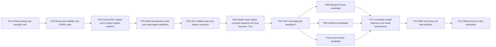
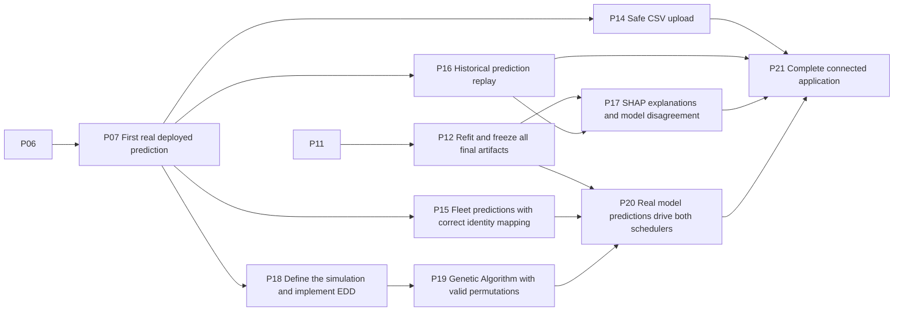
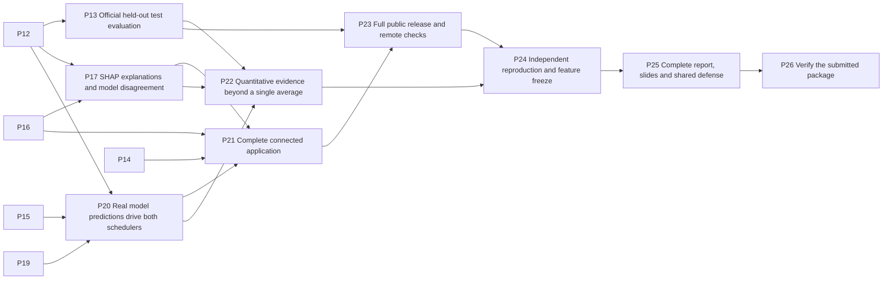

# Dependencies and merge order

The source phase graph is acyclic. Native GitHub blocked-by links represent 37 phase edges and 189 numbered task edges after synchronization; each child is a native sub-issue of its phase parent. A task does not depend on its own parent. Predecessor phase gates are linked in task bodies and on parent issues.

The master plan's 75 focused-hour figure is an optimistic dependency-only lower bound, not total effort or a date promise. P01-P07 are the foundation. P08/P09/P10 are parallel candidate-model branches after P07. P17 and P20 are provisional critical joins; limited three-person availability may change the actual path.

## Foundation and candidate models

## Product and planning

## Release joins

## Actual phase issue references

| Phase | Issue | Hard predecessor phases |
| --- | --- | --- |
| P01 | [#6](https://github.com/Artfever/AI_PROJECT/issues/6) | none |
| P02 | [#7](https://github.com/Artfever/AI_PROJECT/issues/7) | P01 [#6](https://github.com/Artfever/AI_PROJECT/issues/6) |
| P03 | [#8](https://github.com/Artfever/AI_PROJECT/issues/8) | P02 [#7](https://github.com/Artfever/AI_PROJECT/issues/7) |
| P04 | [#9](https://github.com/Artfever/AI_PROJECT/issues/9) | P03 [#8](https://github.com/Artfever/AI_PROJECT/issues/8) |
| P05 | [#10](https://github.com/Artfever/AI_PROJECT/issues/10) | P04 [#9](https://github.com/Artfever/AI_PROJECT/issues/9) |
| P06 | [#11](https://github.com/Artfever/AI_PROJECT/issues/11) | P05 [#10](https://github.com/Artfever/AI_PROJECT/issues/10) |
| P07 | [#12](https://github.com/Artfever/AI_PROJECT/issues/12) | P06 [#11](https://github.com/Artfever/AI_PROJECT/issues/11) |
| P08 | [#13](https://github.com/Artfever/AI_PROJECT/issues/13) | P07 [#12](https://github.com/Artfever/AI_PROJECT/issues/12) |
| P09 | [#14](https://github.com/Artfever/AI_PROJECT/issues/14) | P07 [#12](https://github.com/Artfever/AI_PROJECT/issues/12) |
| P10 | [#15](https://github.com/Artfever/AI_PROJECT/issues/15) | P07 [#12](https://github.com/Artfever/AI_PROJECT/issues/12) |
| P11 | [#20](https://github.com/Artfever/AI_PROJECT/issues/20) | P08 [#13](https://github.com/Artfever/AI_PROJECT/issues/13), P09 [#14](https://github.com/Artfever/AI_PROJECT/issues/14), P10 [#15](https://github.com/Artfever/AI_PROJECT/issues/15) |
| P12 | [#22](https://github.com/Artfever/AI_PROJECT/issues/22) | P11 [#20](https://github.com/Artfever/AI_PROJECT/issues/20) |
| P13 | [#23](https://github.com/Artfever/AI_PROJECT/issues/23) | P12 [#22](https://github.com/Artfever/AI_PROJECT/issues/22) |
| P14 | [#16](https://github.com/Artfever/AI_PROJECT/issues/16) | P07 [#12](https://github.com/Artfever/AI_PROJECT/issues/12) |
| P15 | [#17](https://github.com/Artfever/AI_PROJECT/issues/17) | P07 [#12](https://github.com/Artfever/AI_PROJECT/issues/12) |
| P16 | [#18](https://github.com/Artfever/AI_PROJECT/issues/18) | P07 [#12](https://github.com/Artfever/AI_PROJECT/issues/12) |
| P17 | [#24](https://github.com/Artfever/AI_PROJECT/issues/24) | P12 [#22](https://github.com/Artfever/AI_PROJECT/issues/22), P16 [#18](https://github.com/Artfever/AI_PROJECT/issues/18) |
| P18 | [#19](https://github.com/Artfever/AI_PROJECT/issues/19) | P07 [#12](https://github.com/Artfever/AI_PROJECT/issues/12) |
| P19 | [#21](https://github.com/Artfever/AI_PROJECT/issues/21) | P18 [#19](https://github.com/Artfever/AI_PROJECT/issues/19) |
| P20 | [#25](https://github.com/Artfever/AI_PROJECT/issues/25) | P12 [#22](https://github.com/Artfever/AI_PROJECT/issues/22), P15 [#17](https://github.com/Artfever/AI_PROJECT/issues/17), P19 [#21](https://github.com/Artfever/AI_PROJECT/issues/21) |
| P21 | [#26](https://github.com/Artfever/AI_PROJECT/issues/26) | P14 [#16](https://github.com/Artfever/AI_PROJECT/issues/16), P16 [#18](https://github.com/Artfever/AI_PROJECT/issues/18), P17 [#24](https://github.com/Artfever/AI_PROJECT/issues/24), P20 [#25](https://github.com/Artfever/AI_PROJECT/issues/25) |
| P22 | [#27](https://github.com/Artfever/AI_PROJECT/issues/27) | P13 [#23](https://github.com/Artfever/AI_PROJECT/issues/23), P17 [#24](https://github.com/Artfever/AI_PROJECT/issues/24), P20 [#25](https://github.com/Artfever/AI_PROJECT/issues/25) |
| P23 | [#28](https://github.com/Artfever/AI_PROJECT/issues/28) | P13 [#23](https://github.com/Artfever/AI_PROJECT/issues/23), P21 [#26](https://github.com/Artfever/AI_PROJECT/issues/26) |
| P24 | [#29](https://github.com/Artfever/AI_PROJECT/issues/29) | P22 [#27](https://github.com/Artfever/AI_PROJECT/issues/27), P23 [#28](https://github.com/Artfever/AI_PROJECT/issues/28) |
| P25 | [#30](https://github.com/Artfever/AI_PROJECT/issues/30) | P24 [#29](https://github.com/Artfever/AI_PROJECT/issues/29) |
| P26 | [#31](https://github.com/Artfever/AI_PROJECT/issues/31) | P25 [#30](https://github.com/Artfever/AI_PROJECT/issues/30) |

## Issue to PR route

1. Select one assigned task whose hard predecessor outputs and phase gate are verified. One active implementation task per person is the default.
2. Branch from current `main` as `feat/<task-id>-<description>` (or `fix/` / `chore/`). Do not stack normal implementation PRs on unmerged branches.
3. Implement only the task or a small, clear same-owner packet; run relevant tests and update the owner's handoff file.
4. Open a PR to `main`, link each task issue it truly completes, and record actual evidence. `Closes #N` is for full completion; `Refs #N` is for partial work.
5. One other named teammate approves the latest reviewable revision; required CI and resolved conversations must pass. Native issue dependencies are planning relationships and do not themselves enforce a PR merge gate.
6. After merge, verify issue closure and the phase checklist. A consumer updates from `main` and validates the producer's real interface before relying on it. Close the parent only after all nine tasks and its shared gate have evidence.

Independent ready tasks may merge in either order; shared schema/model/scheduler contracts need coordination and revalidation. A person being busy is not a technical dependency. A downstream draft may use labeled temporary fixtures but must revalidate against merged upstream code before merge.
